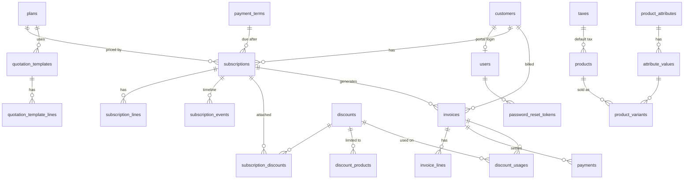

# Brightloop — Subscription Management System

One system to run plans, subscriptions and recurring billing: products and variants, plans, quotation templates, subscriptions with a guarded lifecycle, automatic invoicing, discounts, taxes, payments, a live finance dashboard and a self-service customer portal.

Built for the Odoo hackathon problem statement *Subscription Management System* from scratch: own REST API, PostgreSQL schema written by hand, no backend-as-a-service and no paid third-party APIs.

## Run it

Needs **Node.js 20.12+** and **PostgreSQL 14+**.

```bash
git clone https://github.com/GamerxD01/Odoo-Hackathon.git
cd Odoo-Hackathon
npm install

# Point the API at your PostgreSQL (edit the password to yours)
copy apps\api\.env.example apps\api\.env      # Windows
cp apps/api/.env.example apps/api/.env        # macOS / Linux

npm run setup        # creates the database, migrates, loads demo data
npm run dev          # API on :4000, web app on http://localhost:5173
```

`npm run setup -- --reset` wipes and reloads the demo data. `npm run db:seed:bulk` adds 5,000 customers, 20,000 subscriptions and a year of invoices and payments (about 6 seconds) to try the app at scale. `npm start` builds the web app and serves everything from one port, http://localhost:4000.

| Sign in as | Email | Password |
|---|---|---|
| Admin | `admin@brightloop.test` | `Brightloop@2026` |
| Staff | `staff@brightloop.test` | `Brightloop@2026` |
| Customer (portal) | `iyer.textiles@example.in` | `Brightloop@2026` |

Without SMTP settings, password-reset links and invoice emails are written to the API log, so the whole flow works offline.

## A billing month, end to end

1. **Sign up.** One account per email; passwords need more than 8 characters, an uppercase, a lowercase and a special character, checked live in the form and again by the API. "Forgot password" emails a single-use link that expires in 30 minutes.
2. **Launch a plan.** The admin adds products (name, type, sales and cost price, notes, tax) sold in variants: the *Odoo* brand adds ₹560. A plan sets the price per seat, the billing period (daily, weekly, monthly, yearly, every *n*), minimum seats, availability dates, and whether subscriptions on it auto-close, close early, pause or renew.
3. **Quote to subscription.** Sales starts from a quotation template (plan, lines, validity in days) or from scratch. Totals, tax and discounts update as you type. A subscription moves **Draft → Quotation → Confirmed → Active → Closed** (plus Paused), every step recorded on its timeline; steps cannot be skipped.
4. **Billing day.** One run invoices every due subscription with lines, taxes and discounts filled in, with live progress. Invoices go **Draft → Confirmed → Paid**, can be cancelled, sent and printed.
5. **Better price.** Only the admin creates discount rules: fixed or percentage, minimum purchase or quantity, start and end dates, a use limit, on products or whole subscriptions. Attached to a subscription, a discount appears on each invoice by itself and stops when it expires or runs out.
6. **Money comes in.** Payments are recorded with method, amount, date and note; part payments are allowed, overpayment is refused, and the invoice turns Paid the moment it is settled.
7. **Month end.** The dashboard shows active subscriptions, monthly recurring revenue, collected, outstanding and overdue, filterable by date and plan, and updates live.

Customers sign in to a portal that shows only their own subscriptions and invoices, and can pause, resume, close or renew where their plan allows.

## Architecture

```
apps/
  api/          Express 5 + TypeScript, PostgreSQL via node-postgres (raw SQL)
    src/modules/<domain>/   routes → controller → service → repository
    src/db/migrations/      hand-written SQL schema
  web/          React 18 + Vite + TanStack Query, plain CSS with design tokens
packages/
  shared/       domain rules used by both sides: Zod schemas, pricing engine,
                workflow tables, integer money and UTC date helpers
```

- **Modular monolith.** Each business area (auth, users, customers, catalog, plans, templates, discounts, subscriptions, invoices, billing, payments, reports, portal, realtime) owns its routes, controller, service and repository. Access control is declared once, per mount, in `routes.ts`.
- **One source of truth for rules.** Validation schemas, the pricing engine and the status workflows live in `packages/shared`. The form, the live price preview and the API run the same code, so the browser and the server can never disagree about a price or a field.
- **Realtime without a library.** Services publish an event after their transaction commits; `/api/events` streams them as Server-Sent Events. The browser invalidates the matching queries, so lists, records and the dashboard refresh on their own. Customers only receive events about their own records.

## Database



- **Money is `BIGINT` paise**, rates are basis points (18% = 1800). No floating point touches an amount.
- **"Nothing billed twice"** is enforced by the database: a partial unique index allows one live invoice per subscription per period. The billing run locks its batch with `FOR UPDATE SKIP LOCKED`, so a second run or a second server works on other rows, and re-running is always safe. A subscription that missed periods gets one invoice for each: none are skipped.
- **CHECK constraints** stop overpayment (`amount_paid <= amount_total`), a Paid invoice that isn't fully paid, discount overuse (`times_used <= usage_limit`), negative prices and bad date ranges. Statuses are PostgreSQL enums.
- **Prices are snapshotted** onto subscription and invoice lines, so a later catalog change never rewrites history.
- **Every foreign key and every list filter is indexed**, including a partial index on the billing run's only query path (`next_invoice_date WHERE status = 'active'`).

## Security

- Passwords hashed with bcrypt (cost 12). Sessions are a signed JWT in an **httpOnly, SameSite=Lax** cookie, never readable by scripts.
- Every request re-checks the user row, so deactivating an account or resetting a password ends existing sessions at once (token version).
- Roles: **admin** (everything, including staff and discount rules), **staff** (day-to-day work), **customer** (portal only, scoped to their own records; another customer's record returns 404).
- Reset tokens are random, stored only as SHA-256, single-use and short-lived. "Forgot password" answers the same for known and unknown emails, and login takes the same time either way.
- Auth endpoints are rate-limited. All SQL is parameterised; sort columns come from an allow-list. Helmet sets security headers; request bodies are capped at 100 KB.

## Performance

Measured with the bulk data (20,014 subscriptions, 114,199 invoices, 105,572 payments):

| Screen | API time |
|---|---|
| Dashboard (all figures and the 12-month chart) | 0.15 s |
| Subscriptions list, filtered and sorted | 0.02 s |
| Invoices list / overdue filter | 0.15 s / 0.04 s |
| Payments list | 0.21 s |
| A subscription or invoice record | 0.005 s |

Lists are paged and filtered on the server; dashboard figures are single aggregate queries; slow queries (over 200 ms) are logged.

## Quality

```bash
npm test          # 15 unit tests (pricing, workflow, money, dates, password policy)
                  # + 14 API integration tests against a real PostgreSQL
npm run lint
npm run typecheck
```

The integration tests use a separate `brightloop_test` database (`TEST_DATABASE_URL`) and cover the password policy, unique emails, reset tokens ending sessions, role checks, the subscription workflow, billing idempotency, discount use limits, payments and portal isolation.

Debugging: every response carries an `X-Request-Id`, which also appears in structured logs (pino) and in error bodies; every state change is written to `audit_log` and to the subscription timeline. Errors share one shape: `{ error: { code, message, fieldErrors, requestId } }`.

## API

All under `/api`. Lists accept `page`, `pageSize`, `q`, `sort`, `dir` plus their own filters.

| Area | Endpoints |
|---|---|
| Auth | `POST auth/signup` `auth/login` `auth/logout` `auth/forgot-password` `auth/reset-password`, `GET auth/me` |
| Catalog | `catalog/products` `catalog/taxes` `catalog/payment-terms` `catalog/attributes` (GET; admin POST/PUT) |
| Plans, templates, discounts | `plans` `templates` `discounts` (discounts and plans: admin writes) |
| Sales | `customers`, `subscriptions`, `POST subscriptions/preview`, `POST subscriptions/from-template`, `POST subscriptions/:id/actions` |
| Billing | `GET billing`, `POST billing/run`, `POST billing/subscriptions/:id`, `invoices`, `POST invoices/:id/actions`, `payments` |
| Reports | `GET reports/summary?from&to&planId` |
| Portal | `portal/subscriptions`, `portal/invoices`, `POST portal/subscriptions/:id/actions` |
| Live | `GET events` (Server-Sent Events) |
| Admin | `users` (admin only) |
